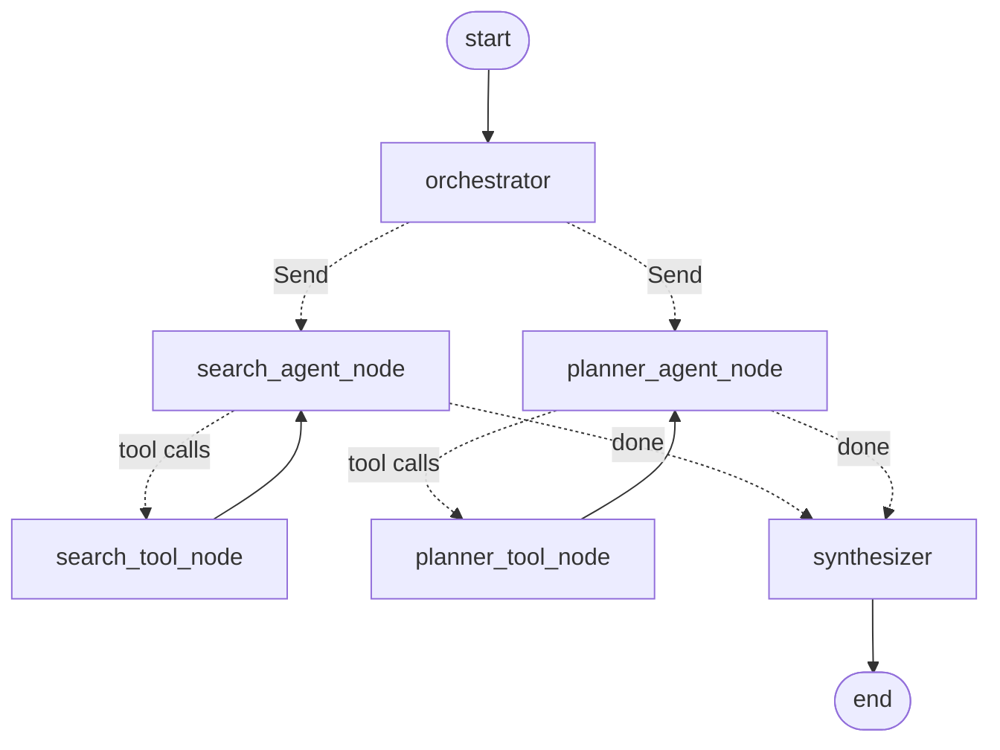

# Multi-Agent Travel Planner

A multi-agent system built with [LangGraph](https://langchain-ai.github.io/langgraph/). It searches flights and hotels, plans day-by-day itineraries, answers general travel questions, and merges everything into one response.

This is the Python version of `Multi-Agent Travel Planner.ipynb`.

New to the code? [`docs/code-map.html`](docs/code-map.html) is a visual guide with flow, sequence and class diagrams and beginner explanations of the Python used. Download it and open it in a browser; GitHub shows HTML files as source code.

---

## What it does

| Request type | Example | Handled by |
|---|---|---|
| Flights / hotels | "Flights JFK → LHR on 2027-01-21 for 1 adult" | Search agent (SerpAPI) |
| General travel question | "Best season to visit Jodhpur?" | Planner agent → web search (Tavily) |
| Itinerary | "Plan 2 days in Agra for a history lover" | Planner agent → itinerary deep-research sub-agent |
| Combined | "Plan 5 days in Paris and find flights from JFK" | Both agents **in parallel**, then the synthesizer |
| Follow-up | "Major historical sites there?" | Uses earlier turns of the same session |

## Architecture



| Node | Role |
|---|---|
| `orchestrator` | Router LLM with structured output (`ClassificationResult`). Splits the request into one task per agent, each with a self-contained sub-query. Uses earlier turns to resolve follow-ups. |
| `search_agent_node` + `search_tool_node` | Flight & hotel agent. Calls `search_flights` / `search_hotels` (SerpAPI Google Flights & Google Hotels) until it has an answer. |
| `planner_agent_node` + `planner_tool_node` | Travel scout. Uses `tavily_search` for quick facts, or `itinerary_research_agent` for day-by-day plans. |
| `itinerary_research_agent` (tool) | A [deepagents](https://github.com/langchain-ai/deepagents) research agent that runs several web searches before writing a detailed itinerary. |
| `synthesizer` | Waits until every dispatched agent has finished. Returns a single answer as-is, or merges several answers with the LLM. |

Agents run in parallel through LangGraph's `Send` API. Each agent keeps its own tool-calling transcript (`search_messages`, `planner_messages`), so parallel branches don't mix their messages.

### Memory

`TravelPlanner` compiles the graph with an `InMemorySaver` checkpointer. Messages in the same `thread_id` share conversation history (`messages`). Per-turn fields (`agent_results`, agent transcripts, `final_answer`) are cleared at the start of each turn. Memory lasts as long as the process runs. To keep it across restarts, pass a persistent checkpointer (for example `langgraph-checkpoint-sqlite`).

## Project layout

```
multi_agent_travel_planner/
├── main.py                     # Command-line interface (chat or one-shot)
├── travel_planner/
│   ├── __init__.py             # Exports TravelPlanner, build_travel_planner_graph
│   ├── config.py               # Settings + API-key loading from env / .env
│   ├── prompts.py              # System prompts for every agent
│   ├── tools.py                # search_flights, search_hotels, Tavily search
│   ├── agents.py               # Chat model, itinerary deep agent, standalone agents
│   └── graph.py                # State, nodes, graph wiring, TravelPlanner class
├── docs/code-map.html          # Visual guide: diagrams + Python explanations
├── tests/test_graph.py         # Offline tests (fake LLM, no API keys)
├── requirements.txt            # Runtime dependencies
├── requirements-dev.txt        # + pytest
├── .env.example                # Template for API keys
└── Multi-Agent Travel Planner.ipynb   # Original notebook
```

## Setup

**Requirements:** Python **3.10 or newer**. LangChain 1.x, LangGraph 1.x and deepagents don't support 3.9.

```bash
# 1. Create a virtual environment (Python 3.10+)
python3.12 -m venv .venv
source .venv/bin/activate          # Windows: .venv\Scripts\activate

# 2. Install dependencies
pip install -r requirements.txt     # or: pip install -r requirements-dev.txt  (adds pytest)

# 3. Add your API keys
cp .env.example .env               # then edit .env
```

### API keys

| Variable | Used for | Get one at |
|---|---|---|
| `OPENAI_API_KEY` | All LLM calls | https://platform.openai.com/api-keys |
| `TAVILY_API_KEY` | Web search (travel facts, itinerary research) | https://app.tavily.com |
| `SERPAPI_API_KEY` (or `SERP_API_KEY`) | Google Flights / Google Hotels | https://serpapi.com/manage-api-key |
| `OPENAI_CHAT_MODEL` *(optional)* | Model name, default `gpt-5.2` | |
| `OPENAI_TEMPERATURE` *(optional)* | Default `0.2` | |

Keys are read from the environment. A `.env` file in the project folder is loaded automatically. The program stops with a clear message if any key is missing.

## Usage

### Command line

```bash
# Interactive chat. Follow-up questions remember context.
python main.py

# One question
python main.py "What is the best time to visit Jaipur?"

# Show which agents were used and each agent's raw answer
python main.py -v "Plan a 3-day trip to Rome and find hotels for 2 adults from 2027-03-10 to 2027-03-13"

# Continue a named conversation
python main.py -t user-01 "Major historical sites there?"

# Print the graph as a Mermaid diagram
python main.py --graph
```

| Option | Meaning |
|---|---|
| `query` | Question to ask. Leave it out for interactive chat. |
| `-t, --thread-id` | Conversation id. Turns with the same id share history (within one run). |
| `-v, --verbose` | Print each node as it finishes, plus tasks and agent results. |
| `--graph` | Print the Mermaid diagram and exit. |
| `--recursion-limit` | Max graph steps per question (default 50). |

Example chat:

```
You: What is the best time to visit Jaipur?
...
You: Major historical sites there (must visit kind of)
...
You: Which nearby cities can I add with only 2-3 extra days?
```

### From Python

```python
from travel_planner import TravelPlanner

planner = TravelPlanner()

# Simple answer
print(planner.ask("Best season to travel to Jodhpur?", thread_id="user-01"))

# Full state: tasks, agent_results, final_answer, messages, ...
state = planner.run(
    "Plan a 5-day trip to Paris and find flights from JFK to CDG for 1 adult on 2027-01-21 (one way)",
    thread_id="user-02",
)
for task in state["tasks"]:
    print(task.source, "->", task.user_query)
print(state["final_answer"])

# Live progress
for node, update in planner.stream_updates("Hotels in London 2027-01-22 to 2027-01-24, 1 adult"):
    print("finished:", node)
```

Use a single agent on its own (like the notebook's test cells):

```python
from travel_planner.agents import create_llm, create_itinerary_tool, create_search_agent, create_travel_scout
from travel_planner.config import Settings
from travel_planner.tools import create_internet_search

Settings.from_env().require_keys()
llm = create_llm()
search = create_internet_search()

search_agent = create_search_agent(llm)
scout = create_travel_scout(llm, search, create_itinerary_tool(llm, search))

result = scout.invoke({"messages": [{"role": "user", "content": "What should I pack for Iceland in March?"}]})
print(result["messages"][-1].text)
```

Build the graph with your own model, tools or checkpointer:

```python
from travel_planner.graph import build_travel_planner_graph

graph = build_travel_planner_graph(llm=my_llm, search_tools=[...], planner_tools=[...], checkpointer=my_saver)
```

## Tools

**`search_flights`**: `departure_airport`, `arrival_airport` (IATA codes), `outbound_date` (YYYY-MM-DD), optional `return_date` (makes it a round trip), `adults`, `children`, `stops` (0 any, 1 nonstop, 2 ≤1 stop, 3 ≤2 stops). Returns up to 10 options with price (USD), duration, layovers and legs.

**`search_hotels`**: `location`, `check_in_date`, `check_out_date`, `adults`, `children`, `rooms`, optional `hotel_class` (e.g. `"4,5"`), `sort_by` (3 price, 8 rating, 13 reviews). Returns the top 5 with nightly and total price, rating, stars and amenities.

**`tavily_search`**: advanced-depth web search, 5 results, with images.

**`itinerary_research_agent`**: takes a full itinerary request and returns a researched day-by-day plan.

The search agent asks for missing details (dates, number of travelers, which airport) instead of guessing. Include them in your question to get results straight away. SerpAPI only returns results for **future** dates.

## Testing

```bash
pip install -r requirements-dev.txt
pytest -q
```

The tests use a scripted fake LLM and fake tools. They need no API keys and no network. They check parallel dispatch, the tool loops, that the synthesizer waits for both agents, follow-up context, and per-turn reset.

## Differences from the notebook

The notebook logic is kept as-is. These changes fix bugs or make the code easier to reuse:

- **Agents keep the user's question during tool loops.** In the notebook, the agent's second call (after a tool result) no longer contained the original question.
- **Per-turn state is cleared.** With a checkpointer, `agent_results` and agent transcripts used to grow from turn to turn. Old answers leaked into new ones, and later turns skipped the new question.
- **Follow-ups work.** The router now sees earlier turns and rewrites references like "there" into self-contained sub-queries.
- **The synthesizer waits for every agent** before merging, instead of possibly running once per branch.
- **Every tool call gets a reply**, including unknown tools and tool errors. The OpenAI API rejects requests with unanswered tool calls.
- The search prompt now names the real tools (`search_flights`, `search_hotels`) instead of their input-schema class names.
- Google Colab `userdata` / `getpass` were replaced with environment variables and a `.env` file.
- The hotel tool also returns the total price and amenities. The flight tool also returns layovers and cabin class.

## Troubleshooting

| Problem | Fix |
|---|---|
| `Missing API key(s): ...` | Add the listed keys to `.env` or your shell environment. |
| `SyntaxError` / install errors about Python version | Use Python 3.10+. Recreate `.venv` with a newer interpreter. |
| `No flights found` / `No hotels found` | Check that dates are in the future and airport codes are valid. |
| `GraphRecursionError` | Raise `--recursion-limit`, or make the request more specific. |
| Itinerary requests are slow | The deep-research agent runs several web searches. 1–2 minutes is normal. |
